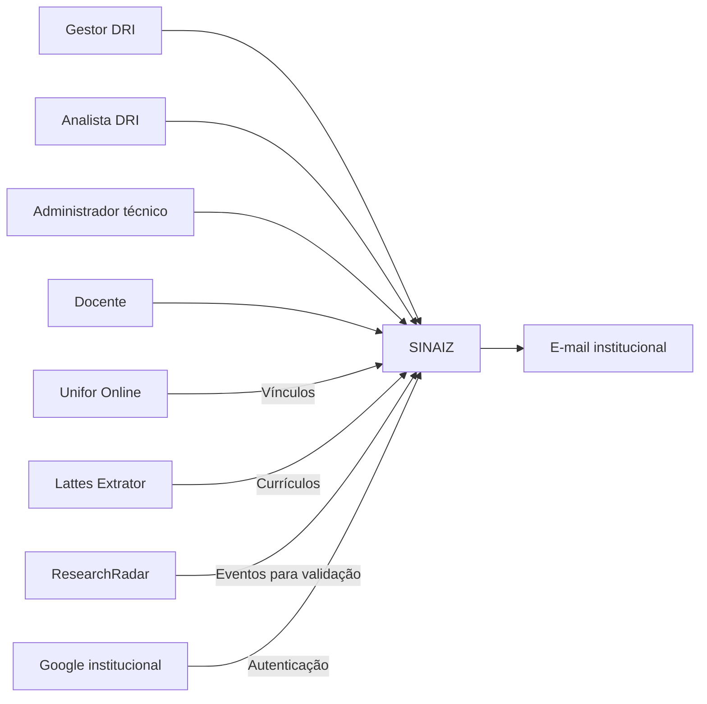
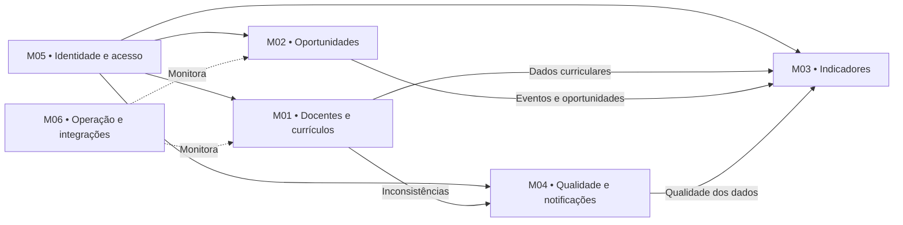

# Visão da Demanda (VD) — SINAIZ


*Identidade visual proposta para o estudo de caso; não representa aprovação institucional da Unifor.*

**Sistema de Inteligência Acadêmica e Internacionalização — exemplo didático LAPIS 2.1**

> **Natureza:** estudo de caso para a disciplina de Requisitos e Modelagem de Sistemas da Unifor. **Não constitui demanda institucional aprovada.** Os pontos levantados em conversa são insumos iniciais; prioridades, metas, autorização de acesso e regras de classificação devem ser validadas com o solicitante.

## Identificação e Histórico

| Campo | Informação |
| --- | --- |
| Nome e identificador da demanda | SINAIZ — VD-SINAIZ-001 (identificador didático) |
| Tipo | Novo sistema com integrações institucionais |
| Sistema ou produto relacionado | Unifor Online (UOL), Plataforma Lattes/CNPq; sistemas de autenticação institucionais a identificar |
| Área solicitante | Diretoria de Relações Internacionais (DRI) da Unifor |
| Interlocutor de negócio | Prof. Marcelo Ponte, Supervisor de Apoio Docente (informação fornecida para o estudo de caso) |
| Contato informado | marceloponte@unifor.br · +55 85 3477-3405 |
| Responsável pela elaboração | Equipe de alunos — exemplo preparado para orientação docente |
| Responsável pela aprovação formal | Direção da DRI (nome e assinatura a confirmar) — **aprovação pendente** |
| Situação | Rascunho didático, não validado |
| Versão e data | 2.4 — 02/11/2026 |

| Data | Versão | Descrição da alteração | Autor |
| --- | --- | --- | --- |
| 02/11/2026 | 1.0 | Consolidação inicial do estudo de caso | Exemplo didático com apoio de IA |
| 02/11/2026 | 1.1 | Inclusão do diagrama de casos de uso na seção de casos de uso da versão 1.1 | Exemplo didático com apoio de IA |
| 02/11/2026 | 1.2 | Alteração do nome do sistema para SINAIZ | Exemplo didático com apoio de IA |
| 02/11/2026 | 2.0 | Consolidação das decisões de elicitação: DRI, perfis, regras de internacionalização, eventos, indicadores, Lattes e pendências | Exemplo didático com apoio de IA |
| 02/11/2026 | 2.1 | Revisão da documentação pelo professor | Revisão do professor |
| 02/11/2026 | 2.2 | Detalhamento da definição, gestão, cálculo e governança dos indicadores de internacionalização | Exemplo didático com apoio de IA |
| 02/11/2026 | 2.3 | Organização em módulos funcionais, diagramas de casos de uso por módulo e inclusão de proposta de logomarca | Exemplo didático com apoio de IA |
| 02/11/2026 | 2.4 | Conversão dos diagramas de casos de uso para notação UML em PlantUML | Exemplo didático com apoio de IA |

## 1. Objetivo

Proporcionar à área de relações internacionais e apoio docente uma visão integrada, pesquisável e histórica da formação, atuação, produção científica e conexões internacionais dos professores vinculados à Unifor, além de oportunidades de publicação e participação em eventos científicos, para subsidiar ações de internacionalização, cooperação e atração de pesquisadores e estudantes estrangeiros.

O sistema **não substitui o Currículo Lattes** nem exige que docentes recadastrem sua produção científica: utiliza, mediante autorização e viabilidade técnica, informações já registradas nas fontes oficiais.

## 2. Contexto, Problema e Descrição Sumária da Demanda

### 2.1 Situação atual — entendimento inicial

- O Unifor Online (UOL) possui informações institucionais sobre docentes e cursos, conforme relato do solicitante do estudo de caso; a estrutura e interfaces disponíveis precisam ser verificadas.
- Os docentes mantêm seus currículos na Plataforma Lattes, incluindo formação acadêmica e produção científica. A periodicidade institucional de atualização relatada precisa de confirmação normativa.
- O levantamento cruzado de titulação no exterior, produção internacional e evolução histórica tende a exigir consultas a fontes separadas. **A dificuldade e o tempo atual de execução ainda não foram medidos.**
- O catálogo institucional de congressos e oportunidades de submissão, com prazos e custos, foi identificado como necessidade de negócio; não se pressupõe que inexista solução atual.

### 2.2 Problema ou oportunidade

A falta de uma visão integrada e analítica, **a confirmar em levantamento**, pode dificultar identificar docentes com conexões internacionais, comparar produção por período, acompanhar oportunidades de publicação e apoiar decisões de internacionalização. O Lattes contém dados curriculares, mas não define, por si só, os indicadores institucionais de internacionalização.

### 2.3 Públicos afetados e impactos

Gestores e analistas de internacionalização, docentes, coordenações acadêmicas, equipes de pesquisa e TI. Potenciais impactos: redução de consultas manuais, melhor descoberta de competências, acompanhamento de resultados e ampliação da visibilidade internacional.

### 2.4 Evidências disponíveis

- Conversa de elicitação preliminar: interesse em formação (instituição, país, nível, período), publicações, congressos, custos, histórico e cooperação internacional.
- Fonte oficial CNPq: o **Lattes Extrator** é um serviço institucional sujeito a habilitação; o CNPq publica um XSD de referência para os XMLs extraídos. Fontes: https://memoria.cnpq.br/web/portal-lattes/extracoes-de-dados e https://www.gov.br/pt-br/servicos/obter-acesso-ao-extrator-da-plataforma-lattes
- Referência institucional indicada: https://unifor.br/dri/inicial. O estudo de caso considera a DRI como demandante e Marcelo Ponte como solicitante, conforme elicitação; aprovação institucional ainda pendente.

### 2.5 Descrição sumária

Disponibilizar consultas de docentes e seus currículos, formação acadêmica, produção científica, conexões e evolução temporal; permitir descoberta e manutenção de oportunidades científicas; produzir indicadores e relatórios com transparência sobre origem, data de atualização e limitações dos dados.

## 3. Proposta de Valor e Sucesso da Demanda

| Benefício esperado | Indicador ou evidência | Resultado desejado (proposta) | Como e quando avaliar |
| --- | --- | --- | --- |
| Encontrar competências internacionais | Tempo para localizar docentes por titulação, país e área | Reduzir o tempo em comparação com linha de base **a medir** | Teste com analistas antes/depois do piloto |
| Melhorar visibilidade da produção | Cobertura de docentes com currículo vinculado e publicações classificáveis | Cobertura acordada com área solicitante; não inventar percentual | Relatório de cobertura por ciclo de sincronização |
| Acompanhar evolução | Séries anuais de produção, com indicação da data de extração | Permitir comparação por período sem confundir data da publicação e data de registro | Homologação de exemplos reais |
| Identificar oportunidades | Congressos válidos com prazo, modalidade, custo e área | Catálogo consultável com informações verificáveis e data de conferência | Auditoria amostral mensal |
| Subsidiar cooperação | Relatórios de coautoria e formação no exterior | Evidenciar redes potenciais, sem presumir convênios formais | Validação com gestores |
| Confiabilidade da informação | Percentual de registros com fonte e data de atualização | Proveniência rastreável em 100% dos dados importados | Testes e auditoria de amostra |

**Metas quantitativas de negócio:** a definir após levantamento da situação atual. Indicadores iniciais serão fornecidos prontos, com construtor guiado de indicadores adicionais.

## 4. Partes Interessadas

| Parte interessada | Papel e interesse | Responsabilidade | Representante |
| --- | --- | --- | --- |
| Universidade de Fortaleza (Unifor) | Instituição responsável | Autorizar eventual implantação e acesso a serviços institucionais | Representação institucional a confirmar |
| Diretoria de Relações Internacionais (DRI) | Unidade demandante e beneficiária inicial | Priorizar necessidades e validar resultados | Direção da DRI |
| Prof. Marcelo Ponte | Solicitante, Supervisor de Apoio Docente | Esclarecer necessidades e acompanhar a elicitação | marceloponte@unifor.br |
| Direção da DRI | Autoridade de aprovação da demanda | Aprovar formalmente a Visão da Demanda | Nome e confirmação formal pendentes |
| Gestores e analistas da DRI | Usuários de negócio | Operar indicadores, oportunidades e inconsistências | Representantes a designar |
| Docentes da Unifor | Usuários de consulta e titulares de dados curriculares | Consultar informações; corrigir o próprio Lattes na fonte | Comunidade docente |
| TI Unifor / UOL / identidade | Provedores de serviços institucionais | Confirmar integrações, vínculos, autenticação e operação | A designar |
| Encarregado de dados / jurídico | Conformidade | Avaliar LGPD, permissões e retenção | A designar |
| CNPq | Provedor de dados curriculares | Disponibilizar Lattes Extrator conforme habilitação | Canal institucional |
| ResearchRadar | Fonte externa inicial de oportunidades | Disponibilizar dados, sujeito a viabilidade de integração | Contato técnico a confirmar |
| Equipe discente | Equipe do projeto didático | Especificar, implementar e testar a solução de estudo | Alunos da disciplina |

**Limite institucional:** a primeira versão atende à DRI; outras diretorias e coordenações são possibilidade de expansão futura, não público operacional inicial.

## 5. Usuários e Atores Externos

| ID | Ator | Responsabilidade e acesso |
| --- | --- | --- |
| AT-01 | Gestor de Internacionalização | Todas as funções de negócio do analista; criar/configurar indicadores e acompanhar resultados; sem administração técnica implícita |
| AT-02 | Analista de Internacionalização | Consultar e exportar, cadastrar oportunidades, validar importações, tratar inconsistências e notificar docentes |
| AT-03 | Administrador Técnico | Administrar perfis, integrações, monitoramento, falhas e logs; acesso técnico restrito |
| AT-04 | Docente | Consultar e exportar dados autorizados de sua produção e de outros docentes; consultar indicadores e oportunidades; sem edição |
| AT-05 | Unifor Online (UOL) | Fonte institucional de docentes, vínculos e identificadores, conforme integração autorizada |
| AT-06 | Lattes Extrator/CNPq | Fonte curricular externa, somente leitura |
| AT-07 | Autenticação institucional via Google | Autenticação conforme mecanismo institucional da Unifor, a confirmar com TI |
| AT-08 | ResearchRadar | Fonte inicial de oportunidades importadas, sujeitas a validação e viabilidade técnica |

O docente é um ator **confirmado**. O UOL informa vínculos; o SINAIZ atribui automaticamente o perfil Docente quando o vínculo é reconhecido. Um Administrador Técnico autorizado concede e revoga perfis de Gestor, Analista e Administrador Técnico, com auditoria. Todos usam a mesma estrutura de tela inicial, com ações condicionadas às permissões; as permissões são verificadas no servidor.

## 6. Necessidades e Catálogo de Funcionalidades

### 6.1 Necessidades

| ID | Necessidade | Atores relacionados |
| --- | --- | --- |
| NEC-01 | Identificar docentes e vínculos ativos da Unifor | AT-01, AT-02, AT-04, AT-05 |
| NEC-02 | Importar e consultar currículos Lattes com sincronização semanal e rastreabilidade | AT-02, AT-03, AT-06 |
| NEC-03 | Consultar formação, titulação e trajetória acadêmica | AT-01, AT-02, AT-04 |
| NEC-04 | Pesquisar publicações e classificar sua internacionalização por veículo/editor | AT-01, AT-02, AT-04 |
| NEC-05 | Acompanhar evolução histórica e indicadores institucionais | AT-01, AT-02, AT-04 |
| NEC-06 | Cadastrar, importar, validar e consultar congressos e oportunidades | AT-01, AT-02, AT-04, AT-08 |
| NEC-07 | Tratar inconsistências sem alterar dados oficiais, notificando docentes | AT-01, AT-02 |
| NEC-08 | Consultar, exportar e criar indicadores com construtor guiado | AT-01, AT-02, AT-04 |
| NEC-09 | Autenticar usuários, atribuir perfis, preservar auditoria e proteger dados | AT-03, AT-05, AT-07 |
| NEC-10 | Definir, documentar, validar e versionar indicadores institucionais de internacionalização | AT-01 |
| NEC-11 | Acompanhar metas e resultados dos indicadores por períodos e recortes institucionais | AT-01, AT-02, AT-04 |

### 6.2 Funcionalidades

| ID | Funcionalidade e resultado esperado | Necessidade | Atores | Prioridade | Especificação |
| --- | --- | --- | --- | --- | --- |
| F-01 | Sincronizar docentes e vínculos do UOL | NEC-01 | AT-03, AT-05 | Essencial | CDU-01 |
| F-02 | Vincular ID Lattes e sinalizar ausências/duplicidades | NEC-02, NEC-07 | AT-02, AT-06 | Essencial | CDU-02 |
| F-03 | Verificar semanalmente alterações curriculares e importar dados autorizados, registrando fonte, data, versão e falhas; continuar lote apesar de erros individuais | NEC-02 | AT-03, AT-06 | Essencial | CDU-03 |
| F-04 | Pesquisar docentes por nome, curso, área e unidade | NEC-01 | AT-01, AT-02, AT-04 | Essencial | CDU-04 |
| F-05 | Consultar formação por nível, instituição, país e período | NEC-03 | AT-01, AT-02, AT-04 | Essencial | CDU-05 |
| F-06 | Pesquisar publicações por tipo, ano, periódico/editora, DOI e docente | NEC-04 | AT-01, AT-02, AT-04 | Essencial | CDU-06 |
| F-07 | Classificar internacionalização conforme regras de negócio aprovadas; indicar dados insuficientes | NEC-04 | AT-01, AT-02, AT-04 | Essencial | CDU-07 |
| F-08 | Consultar histórico de produção e evolução anual | NEC-05 | AT-01, AT-02, AT-04 | Essencial | CDU-08 |
| F-09 | Cadastrar e alterar manualmente oportunidades, com publicação imediata e auditoria | NEC-06 | AT-01, AT-02 | Essencial | CDU-09 |
| F-10 | Importar oportunidades do ResearchRadar para fila de validação; somente publicar após aprovação | NEC-06 | AT-01, AT-02, AT-08 | Essencial* | CDU-10 |
| F-11 | Detectar duplicidade de oportunidades e impedir novo cadastro, registrando ocorrência em log e aviso ao analista | NEC-06, NEC-09 | AT-01, AT-02 | Essencial | CDU-11 |
| F-12 | Pesquisar oportunidades por área, prazo, país, custo e modalidade | NEC-06 | AT-01, AT-02, AT-04 | Essencial | CDU-12 |
| F-13 | Consultar indicadores predefinidos e exportar consultas autorizadas para Excel/PDF | NEC-08 | AT-01, AT-02, AT-04 | Essencial | CDU-13 |
| F-14 | Criar/configurar indicadores com medidas, filtros, agrupamentos e gráficos predefinidos, sem SQL ou fórmulas livres | NEC-08 | AT-01 | Essencial | CDU-14 |
| F-15 | Gerenciar Central de Inconsistências: pendente, em análise, resolvida; manter histórico após resolução | NEC-07 | AT-01, AT-02 | Essencial | CDU-15 |
| F-16 | Notificar docente por e-mail institucional mediante ação do analista/gestor; permitir reenvios e registrar histórico | NEC-07 | AT-01, AT-02 | Essencial | CDU-16 |
| F-17 | Autenticar via identidade institucional Google e consultar vínculo no UOL, sem senha própria | NEC-09 | AT-05, AT-07 | Essencial* | CDU-17 |
| F-18 | Gerenciar atribuição/revogação de perfis e trilha de auditoria | NEC-09 | AT-03 | Essencial | CDU-18 |
| F-19 | Monitorar importações, falhas, logs e reprocessamentos controlados | NEC-09 | AT-03 | Essencial | CDU-19 |
| F-20 | Manter catálogo de indicadores com nome, objetivo, definição, unidade, fonte, periodicidade, responsável e situação | NEC-10 | AT-01 | Essencial | CDU-20 |
| F-21 | Definir indicador em assistente guiado: medida, universo, filtros, dimensão, agregação, período e visualização, com prévia do resultado | NEC-10 | AT-01 | Essencial | CDU-21 |
| F-22 | Configurar regras de cálculo e tratamento de duplicidades, ausência de dados e registros não classificáveis, usando opções controladas | NEC-10 | AT-01 | Essencial | CDU-22 |
| F-23 | Salvar rascunho, validar, ativar, desativar e versionar definição de indicador; preservar histórico e autoria | NEC-10, NEC-09 | AT-01 | Essencial | CDU-23 |
| F-24 | Definir metas por indicador, período e recorte institucional e comparar realizado com meta | NEC-11 | AT-01 | Desejável* | CDU-24 |
| F-25 | Exibir painel de indicadores com séries históricas, filtros, detalhamento dos registros de origem e exportação Excel/PDF | NEC-08, NEC-11 | AT-01, AT-02, AT-04 | Essencial | CDU-25 |
| F-26 | Sinalizar atualização pendente, cobertura insuficiente e inconsistências que afetem os resultados de cada indicador | NEC-10, NEC-11 | AT-01, AT-02, AT-04 | Essencial | CDU-26 |

**Regras de negócio consolidadas:** (a) artigo internacional: periódico sediado fora do Brasil; (b) livro/capítulo internacional: editora sediada fora do Brasil; (c) evento presencial: realizado fora do Brasil; (d) evento virtual: organizado por instituição sediada fora do Brasil; (e) evento híbrido: local da realização presencial, registrando modalidade; (f) parcerias formais e identificação de países de coautores ficam fora do escopo inicial. Dados importados do Lattes **não são editáveis** no SINAIZ. Inconsistências corrigidas desaparecem da lista ativa, mas continuam no histórico; a confirmação de correção ocorre em sincronização posterior.

\* Integração técnica com ResearchRadar e mecanismo de autenticação institucional dependem de validação de viabilidade. As prioridades refletem decisões de elicitação para o estudo de caso; a aprovação institucional permanece pendente.

### 6.3 Exemplos de consultas para validação

- Quais docentes da Unifor publicaram em periódicos sediados fora do Brasil em 2026?
- Quantos livros e capítulos foram publicados por editoras estrangeiras, por curso?
- Quais congressos internacionais virtuais, presenciais ou híbridos têm submissão aberta?
- Quais eventos importados do ResearchRadar aguardam validação e quais foram bloqueados por duplicidade?
- Quais inconsistências do Lattes aguardam correção e quais notificações já foram enviadas?
- Como evoluiu a quantidade de publicações internacionais por ano e curso?

### 6.4 Definição e gestão dos indicadores de internacionalização

**Objetivo.** Permitir que o Gestor de Internacionalização estabeleça e mantenha indicadores institucionais por meio de uma interface guiada, sem escrever SQL, scripts ou fórmulas arbitrárias. Os indicadores predefinidos continuam disponíveis; novos indicadores devem ser configurados a partir de medidas e dimensões previamente homologadas. Os itens abaixo são **propostas de detalhamento para validação pela DRI**, não regras institucionais já aprovadas.

#### 6.4.1 Catálogo inicial proposto

| ID | Indicador proposto | Medida e unidade | Recortes sugeridos | Fonte primária |
| --- | --- | --- | --- | --- |
| IND-01 | Docentes com formação acadêmica no exterior | Quantidade de docentes distintos | Ano, curso, nível de titulação, país | Lattes + UOL |
| IND-02 | Publicações em periódicos internacionais | Quantidade de artigos distintos | Ano de publicação, curso, docente, país do periódico | Lattes + classificação |
| IND-03 | Livros e capítulos publicados por editoras estrangeiras | Quantidade de obras distintas, por tipo | Ano, curso, tipo, país da editora | Lattes + classificação |
| IND-04 | Participação em eventos científicos internacionais | Quantidade de participações registradas | Ano, curso, modalidade, país | Lattes + classificação |
| IND-05 | Evolução anual da produção internacional | Quantidade de produções distintas por ano | Curso, tipo de produção, período | Lattes + classificação |
| IND-06 | Oportunidades internacionais com submissão aberta | Quantidade de oportunidades vigentes | Área, país, modalidade, prazo | Cadastro manual + ResearchRadar |
| IND-07 | Cobertura e qualidade dos dados curriculares | Percentual de docentes com Lattes sincronizado e classificável | Curso, ciclo de sincronização | UOL + Lattes + inconsistências |

**Observações:** as definições exatas de “participação”, “produção distinta” e “cobertura” exigem homologação com a DRI. Um indicador não deve presumir que a produção foi realizada durante o vínculo com a Unifor: é necessário definir expressamente o recorte temporal e o tratamento de docentes inativos.

#### 6.4.2 Atributos obrigatórios da definição

Cada indicador deverá possuir, no mínimo: código único; nome; finalidade/pergunta de negócio; descrição; medida e unidade; população considerada; regras de inclusão/exclusão; fonte de dados; periodicidade e data de referência; filtros e dimensões permitidos; regra de agregação; tratamento de duplicidades e ausências; responsável; status (rascunho, ativo, inativo); versão e histórico de alterações. Meta e visualização são opcionais, quando aplicáveis.

#### 6.4.3 Fluxo de configuração (Gestor)

1. Abrir **Indicadores → Novo indicador** ou duplicar uma definição existente.
2. Informar nome, objetivo e selecionar uma **medida homologada** (contagem, percentual ou série temporal disponível).
3. Selecionar universo de dados (docentes ativos, histórico institucional ou outro conjunto autorizado), período e data de referência.
4. Escolher filtros (curso, área, país, tipo de produção, modalidade, ano) e agrupamentos permitidos.
5. Definir opções controladas de cálculo, incluindo deduplicação e tratamento de dados insuficientes.
6. Visualizar prévia do resultado, quantidade de registros considerados, excluídos e não classificáveis.
7. Salvar rascunho; revisar consistência; **ativar** a versão. Uma alteração posterior gera nova versão sem apagar a anterior.
8. Consultar o painel, comparar períodos e exportar dados e definição metodológica para Excel/PDF, respeitando permissões.

#### 6.4.4 Regras de negócio propostas

- **RN-IND-01 — Exclusividade de configuração:** somente o Gestor de Internacionalização cria, altera, ativa, inativa ou define metas. Analista e Docente consultam indicadores publicados, respeitando as autorizações.
- **RN-IND-02 — Definições rastreáveis:** todo resultado apresenta versão da definição, fonte, data da última sincronização, período analisado e critérios utilizados.
- **RN-IND-03 — Deduplicação:** a mesma publicação não deve ser contada mais de uma vez no total institucional por aparecer em currículos de vários coautores; a visualização *por docente* pode atribuí-la a cada participante, com aviso de que a soma por docente pode superar o total institucional.
- **RN-IND-04 — Denominadores explícitos:** percentuais devem apresentar numerador, denominador e regra de seleção dos docentes; denominador zero produz “não calculável”, nunca 0% por conveniência.
- **RN-IND-05 — Dados incompletos:** registros sem informações suficientes para classificar internacionalização ficam em categoria “não classificável”; não são presumidos nacionais nem internacionais.
- **RN-IND-06 — Comparabilidade:** alterações de critérios ou filtros que afetem o cálculo exigem nova versão; relatórios históricos identificam qual versão foi usada.
- **RN-IND-07 — Vínculo e histórico:** docentes inativos permanecem nos registros históricos; o gestor deve selecionar explicitamente se o indicador considera vínculo na data do evento, vínculo atual ou todo o acervo curricular. A disponibilidade do histórico de vínculos precisa ser validada.
- **RN-IND-08 — Publicação controlada:** definições em rascunho não aparecem como indicadores oficiais; inativar um indicador impede novas consultas públicas à versão inativa, mas preserva auditoria e relatórios já emitidos conforme política de retenção.
- **RN-IND-09 — Metas:** metas, quando habilitadas, têm unidade compatível com o indicador e vigência definida; a comparação deve diferenciar resultado absoluto, percentual de atingimento e tendência.
- **RN-IND-10 — Segurança:** não há SQL livre nem acesso direto à base pelo construtor; somente medidas, dimensões e filtros liberados pelo sistema.

#### 6.4.5 Exemplos de critérios de aceitação

| ID | Cenário verificável | Resultado esperado |
| --- | --- | --- |
| CA-IND-01 | Gestor define artigos internacionais de 2026 por curso | Prévia apresenta totais, filtros, fonte e data de extração |
| CA-IND-02 | Dois docentes são coautores do mesmo artigo | Total institucional conta uma publicação; visão por docente mostra participação de ambos |
| CA-IND-03 | Periódico sem país identificável | Registro sinalizado como “não classificável” e não contado como internacional |
| CA-IND-04 | Gestor altera regra de um indicador ativo | Nova versão criada; versão anterior permanece auditável |
| CA-IND-05 | Docente tenta editar indicador | Ação não é disponibilizada e a API recusa a operação |
| CA-IND-06 | Percentual com denominador zero | Sistema exibe “não calculável” e explicação |
| CA-IND-07 | Gestor exporta relatório | Arquivo inclui resultados e identificação dos critérios e da versão |

#### 6.4.6 Questões a validar com a DRI

- Quais indicadores e metas devem ser considerados **oficiais** e quais são apenas análises exploratórias?
- A contagem de produções deve considerar todo o Lattes ou apenas a produção durante o vínculo institucional?
- Qual a unidade organizacional oficial para agrupamento (curso, programa, centro, departamento) e como tratar docentes com múltiplos vínculos?
- Quais medidas e dimensões devem compor a primeira versão do construtor?
- Quem valida a metodologia e a publicação de indicadores institucionais, caso o Gestor não seja o aprovador final?

## 7. Visão Geral da Solução e Impactos

O SINAIZ atende inicialmente à **DRI da Unifor**, com possibilidade arquitetural de expansão para outras unidades. O sistema não substitui UOL nem Lattes, não altera dados curriculares oficiais e não mantém senhas próprias. O acesso é autenticado pelo mecanismo institucional baseado em Google; o vínculo vem do UOL; o SINAIZ controla perfis e autorizações. A disponibilidade e os contratos dessas integrações devem ser verificados com TI.

**Fontes:** Unifor Online (docentes/vínculos), Lattes Extrator (currículos), ResearchRadar (oportunidades importadas, após validação) e cadastro manual (publicação imediata). A arquitetura deve permitir novas fontes externas sem incorporá-las ao escopo da primeira versão.

**Interface:** tela inicial comum a todos os perfis, exibindo ações conforme autorização; checagem efetiva de permissões no servidor. Consultas e exportações Excel/PDF disponíveis a todos os perfis dentro do conjunto de dados autorizado.

### 7.1 Sistemas e processos impactados

| Sistema ou processo | Impacto | Situação |
| --- | --- | --- |
| UOL | Identificar docentes e vínculos institucionais | Contrato/API a confirmar com TI |
| Identidade institucional Google | Autenticação sem senha local | Fluxo e integração a confirmar com TI |
| Lattes Extrator | Sincronização semanal, sem edição de origem | Habilitação, limites e detecção de alterações a confirmar |
| ResearchRadar | Importar eventos para fila de validação | API, termos e cobertura a verificar |
| DRI | Consultas, indicadores, curadoria e inconsistências | Processo de negócio definido em elicitação |
| E-mail institucional | Notificações manuais a docentes | Serviço de envio a confirmar com TI |

### 7.2 Representação de contexto — conceitual



### 7.3 Decomposição funcional do SINAIZ em módulos

Para tornar os casos de uso legíveis, o sistema foi dividido em **seis módulos funcionais**. A divisão é lógica e **não implica** seis aplicações independentes ou microsserviços. Os atores e as permissões permanecem os mesmos definidos na seção 5.

| Módulo | Responsabilidade | Funcionalidades | Atores principais |
| --- | --- | --- | --- |
| **M01 — Docentes e Currículos** | Sincronização institucional, identificação de docentes, formação, produção e classificação internacional | F-01 a F-08 | Gestor, Analista, Docente, Administrador Técnico; UOL e Lattes |
| **M02 — Oportunidades Científicas** | Cadastro, importação, validação, deduplicação e consulta de congressos e oportunidades | F-09 a F-12 | Gestor, Analista, Docente; ResearchRadar |
| **M03 — Indicadores de Internacionalização** | Catálogo, definição, regras de cálculo, versões, metas, painéis e exportação | F-13, F-14, F-20 a F-26 | Gestor, Analista e Docente |
| **M04 — Qualidade de Dados e Notificações** | Central de inconsistências, histórico e comunicação com docentes | F-15 e F-16 | Gestor e Analista; serviço de e-mail institucional |
| **M05 — Identidade e Controle de Acesso** | Login institucional e concessão/revogação de perfis | F-17 e F-18 | Administrador Técnico; identidade institucional e UOL |
| **M06 — Operação e Integrações** | Monitoramento de sincronizações, falhas, logs e reprocessamento | F-19 | Administrador Técnico; fontes integradas |

**Rastreabilidade:** cada funcionalidade F-01 a F-26 pertence a um módulo responsável, sem alterar sua numeração nem o caso de uso CDU correspondente. Há dependências entre módulos: por exemplo, M03 consome dados de M01, M02 e M04; M05 controla acesso a todos; M06 acompanha integrações de M01 e M02.

### 7.4 Mapa dos módulos e dependências



### 7.5 Diagramas de casos de uso por módulo

**Notação:** os diagramas usam a sintaxe UML de casos de uso do PlantUML: atores e sistemas externos ficam fora da fronteira do SINAIZ; os casos de uso ficam dentro da fronteira do módulo representado. Os módulos são recortes lógicos do mesmo sistema, não aplicações independentes. Os IDs `CDU-xx` são os mesmos do catálogo da seção 6.2. Os relacionamentos `include` e `extend` só devem ser acrescentados quando confirmados pelos fluxos detalhados.

#### 7.5.1 M01 — Docentes e Currículos

```plantuml
left to right direction
actor "Gestor de Internacionalização" as G
actor "Analista de Internacionalização" as A
actor Docente as D
actor "Administrador Técnico" as T
actor UOL as U <<sistema externo>>
actor "Lattes Extrator/CNPq" as L <<sistema externo>>

rectangle "SINAIZ — M01: Docentes e Currículos" {
  usecase "CDU-01\nSincronizar vínculos" as CDU01
  usecase "CDU-02\nVincular ID Lattes" as CDU02
  usecase "CDU-03\nSincronizar currículos" as CDU03
  usecase "CDU-04\nPesquisar docentes" as CDU04
  usecase "CDU-05\nConsultar formação" as CDU05
  usecase "CDU-06\nPesquisar publicações" as CDU06
  usecase "CDU-07\nClassificar internacionalização" as CDU07
  usecase "CDU-08\nConsultar histórico" as CDU08
}

U -- CDU01
U -- CDU02
L -- CDU03
T -- CDU01
T -- CDU03
G -- CDU04
A -- CDU04
D -- CDU04
G -- CDU05
A -- CDU05
D -- CDU05
G -- CDU06
A -- CDU06
D -- CDU06
G -- CDU08
A -- CDU08
D -- CDU08
CDU06 ..> CDU07 : <<include>>
```

#### 7.5.2 M02 — Oportunidades Científicas

```plantuml
left to right direction
actor "Gestor de Internacionalização" as G
actor "Analista de Internacionalização" as A
actor Docente as D
actor ResearchRadar as R <<sistema externo>>

rectangle "SINAIZ — M02: Oportunidades Científicas" {
  usecase "CDU-09\nCadastrar e alterar oportunidade" as CDU09
  usecase "CDU-10\nImportar e validar oportunidades" as CDU10
  usecase "CDU-11\nDetectar duplicidades" as CDU11
  usecase "CDU-12\nPesquisar oportunidades" as CDU12
}

G -- CDU09
A -- CDU09
G -- CDU10
A -- CDU10
R -- CDU10
G -- CDU12
A -- CDU12
D -- CDU12
CDU09 ..> CDU11 : <<include>>
CDU10 ..> CDU11 : <<include>>
```

#### 7.5.3 M03 — Indicadores de Internacionalização

```plantuml
left to right direction
actor "Gestor de Internacionalização" as G
actor "Analista de Internacionalização" as A
actor Docente as D

rectangle "SINAIZ — M03: Indicadores de Internacionalização" {
  usecase "CDU-13\nConsultar e exportar indicadores" as CDU13
  usecase "CDU-14\nConfigurar indicador guiado" as CDU14
  usecase "CDU-20\nManter catálogo" as CDU20
  usecase "CDU-21\nDefinir indicador e prévia" as CDU21
  usecase "CDU-22\nDefinir regras de cálculo" as CDU22
  usecase "CDU-23\nVersionar e ativar" as CDU23
  usecase "CDU-24\nDefinir metas" as CDU24
  usecase "CDU-25\nConsultar painéis" as CDU25
  usecase "CDU-26\nVerificar qualidade do resultado" as CDU26
}

G -- CDU13
A -- CDU13
D -- CDU13
G -- CDU14
G -- CDU20
G -- CDU21
G -- CDU22
G -- CDU23
G -- CDU24
G -- CDU25
A -- CDU25
D -- CDU25
G -- CDU26
A -- CDU26
D -- CDU26
```

*Nota:* CDU-14 representa a experiência de construção guiada; CDU-21 detalha a definição e a prévia. A fronteira exata entre esses dois casos de uso deverá ser refinada na especificação para evitar redundância. Os relacionamentos entre esses casos não foram representados como `include` ou `extend`, pois precisam ser confirmados na especificação dos fluxos.

#### 7.5.4 M04 — Qualidade de Dados e Notificações

```plantuml
left to right direction
actor "Gestor de Internacionalização" as G
actor "Analista de Internacionalização" as A
actor "Serviço de e-mail institucional" as E <<sistema externo>>

rectangle "SINAIZ — M04: Qualidade de Dados e Notificações" {
  usecase "CDU-15\nTratar inconsistências" as CDU15
  usecase "CDU-16\nNotificar docente e registrar reenvios" as CDU16
}

G -- CDU15
A -- CDU15
G -- CDU16
A -- CDU16
E -- CDU16
```

#### 7.5.5 M05 — Identidade e Controle de Acesso

```plantuml
left to right direction
actor "Gestor de Internacionalização" as G
actor "Analista de Internacionalização" as A
actor Docente as D
actor "Administrador Técnico" as T
actor "Identidade institucional Google" as I <<sistema externo>>
actor UOL as U <<sistema externo>>

rectangle "SINAIZ — M05: Identidade e Controle de Acesso" {
  usecase "CDU-17\nAutenticar e reconhecer vínculo" as CDU17
  usecase "CDU-18\nGerenciar perfis e permissões" as CDU18
}

G -- CDU17
A -- CDU17
D -- CDU17
T -- CDU17
I -- CDU17
U -- CDU17
T -- CDU18
```

#### 7.5.6 M06 — Operação e Integrações

```plantuml
left to right direction
actor "Administrador Técnico" as T
actor UOL as U <<sistema externo>>
actor "Lattes Extrator/CNPq" as L <<sistema externo>>
actor ResearchRadar as R <<sistema externo>>

rectangle "SINAIZ — M06: Operação e Integrações" {
  usecase "CDU-19\nMonitorar integrações, logs e reprocessamentos" as CDU19
}

T -- CDU19
U -- CDU19
L -- CDU19
R -- CDU19
```

### 7.6 Orientações para a modelagem dos alunos

1. O **mapa de módulos** mostra organização funcional e dependências, não interações UML entre atores e casos de uso.
2. Os **diagramas por módulo** devem permanecer pequenos; quando um caso de uso tiver muitos fluxos alternativos, detalhá-lo em documento próprio.
3. **Não confundir** ator externo com usuário humano: UOL, Lattes, ResearchRadar e identidade institucional são sistemas externos.
4. **Autenticação e autorização** são responsabilidades transversais; não é necessário desenhar o login em todos os diagramas.
5. **Importação agendada** é um comportamento automático do sistema, embora a fonte externa participe da integração; os fluxos de agendamento e falha serão detalhados nos CDUs.
6. Os relacionamentos `include` e `extend` não devem ser inferidos de dependências conceituais; acrescentá-los somente após confirmar os fluxos e a obrigatoriedade ou condição de cada comportamento.

## 8. Condições Gerais da Demanda

| Tipo | Condição |
| --- | --- |
| Escopo inicial | Operação da DRI; expansão a outras unidades somente futura |
| Integridade | Dados do Lattes são somente leitura e corrigidos exclusivamente na fonte |
| Periodicidade | Verificação semanal de alterações curriculares, condicionada à viabilidade do serviço |
| Continuidade | Falha ou incompletude de um currículo não interrompe os demais |
| Internacionalização | Critérios por veículo/editora/local/organizador, conforme modalidade |
| Oportunidades | Cadastro manual publica imediatamente; importação externa requer validação |
| Auditoria | Rastrear importações, bloqueios de duplicidade, correções, perfis e notificações |
| Acesso | Identidade institucional, perfis por autorização e exportação apenas do conteúdo permitido |
| Privacidade | LGPD, retenção e compartilhamento sujeitos à validação institucional |

## 9. Riscos e Questões em Aberto

| ID | Situação | Questão / decisão | Próxima ação e responsável |
| --- | --- | --- | --- |
| PQ-01 | **Aberta — técnica** | Disponibilidade de API/extração autorizada do UOL, vínculos e identificador Lattes | Validar com TI Unifor |
| PQ-02 | **Aberta — técnica/institucional** | Habilitação e condições do Lattes Extrator, limites, sincronização semanal e identificação de alterações | Validar com TI/CNPq |
| PQ-03 | **Resolvida para a versão inicial** | Artigos: periódico estrangeiro; livros/capítulos: editora estrangeira; eventos: local ou organizador conforme modalidade. Parcerias internacionais ficam para depois | Validar exemplos com DRI na homologação |
| PQ-04 | **Parcial — viabilidade técnica aberta** | Periodicidade desejada semanal, sem interromper lote por inconsistência individual | Confirmar suporte e limites do CNPq |
| PQ-05 | **Parcial — integração aberta** | Manual publica imediatamente; ResearchRadar exige validação; duplicidades bloqueadas, auditadas e notificadas | Verificar API/termos do ResearchRadar e disponibilidade de dados atualizados |
| PQ-06 | **Adiada — fora do escopo inicial** | Enriquecimento de país/instituição de coautores não é necessário para critérios iniciais | Reavaliar apenas em evolução futura |
| PQ-07 | **Parcial — conformidade aberta** | Perfis e exportação definidos; falta validar privacidade, retenção, acesso e integração com identidade Google/UOL | TI, encarregado de dados e jurídico |
| PQ-08 | **Resolvida no negócio; detalhes técnicos pendentes** | Central de Inconsistências, histórico, notificação manual por e-mail, reenvio e correção somente no Lattes | Detalhar casos de uso e confirmar serviço de e-mail |
| PQ-09 | **Parcial — detalhamento proposto** | Catálogo inicial, construtor guiado, regras de cálculo, versionamento e critérios de aceite detalhados na seção 6.4 | Validar indicadores oficiais, metodologia e metas com DRI |
| PQ-10 | **Resolvida quanto a papéis; aprovação pendente** | DRI demandante; Prof. Marcelo Ponte solicitante; diretor(a) da DRI aprovador(a) | Confirmar nome/cargo vigente e obter aprovação formal |
| PQ-11 | **Aberta — técnica** | Mecanismo de login Google institucional, integração com UOL e concessão de perfis no SINAIZ | Validar com TI/identidade |
| PQ-12 | **Aberta — técnica** | Integração de envio de e-mail institucional, logs e tratamento de falhas | Validar com TI |
| PQ-13 | **Aberta — negócio** | Definir universo temporal, produção durante vínculo, múltiplos cursos e aprovação metodológica de indicadores | Elicitar e homologar com DRI e TI/UOL |

**Critério de leitura:** “resolvida no negócio” não significa implantação autorizada nem viabilidade técnica comprovada.

## 10. Documentos Relacionados

| Documento | Conteúdo sob sua responsabilidade | Referência e situação |
| --- | --- | --- |
| Especificação de Requisitos Não Funcionais | Qualidade, segurança, integração, critérios verificáveis | `02-requisitos-nao-funcionais-SINAIZ.md` — exemplo elaborado |
| Glossário | Conceitos acadêmicos, curriculares e técnicos | `03-glossario-SINAIZ.md` — exemplo elaborado |
| Casos de uso CDU-01 a CDU-26 | Fluxos, exceções, pré/pós-condições, aceitação | A elaborar |
| Regras de classificação de internacionalização | Taxonomia e exemplos por modalidade | Critérios iniciais definidos; exemplos e exceções a detalhar |
| Arquitetura e contratos | Escolha de persistência, APIs, mapeamento XML, segurança | A elaborar após prova de conceito |
| XSD oficial Lattes | Estrutura de dados curricular | https://memoria.cnpq.br/documents/313759/265384ab-853a-4959-bbeb-fccac2639a7e |
| Serviço Lattes Extrator | Condições institucionais de acesso | https://www.gov.br/pt-br/servicos/obter-acesso-ao-extrator-da-plataforma-lattes |
| Página institucional indicada | Contexto de relações internacionais | https://unifor.br/dri/inicial — conteúdo não verificado nesta elaboração |

## 11. Validação da Visão

### 11.1 Checklist

- [x] Objetivo, contexto e problema descritos; hipóteses explicitadas.
- [x] Benefícios e indicadores propostos, sem inventar linha de base.
- [x] Stakeholders, atores, escopo e exclusões identificados.
- [x] Necessidades e funcionalidades com IDs e rastreabilidade.
- [x] Integrações e riscos relevantes identificados.
- [x] Decisões preliminares de escopo, perfis, critérios e prioridades levantadas em conversa; aprovação institucional ainda pendente.
- [ ] Acesso ao UOL/Lattes confirmado por responsáveis técnicos.
- [ ] Revisão jurídica/privacidade realizada.
- [ ] Casos de uso e regras de negócio detalhados e revisados.

### 11.2 Critérios de conclusão e encaminhamento

**Condição atual:** rascunho de elicitação, **não validado**. Pode orientar especificação acadêmica simulada, mas não autoriza implementação institucional ou acesso a dados reais.

### 11.3 Registro da validação

| Versão | Responsável e papel | Data | Condição da VD | Resultado e ressalvas |
| --- | --- | --- | --- | --- |
| 1.0 | Professor da disciplina — uso didático | 02/11/2026 | Rascunho | Exemplo para discussão, não aprovado pelo solicitante |
| 2.2 | Direção da DRI (aprovação formal) | A definir | Pendente | Nome, assinatura e validação institucional a obter |

---

### Orientação didática complementar

Utilize a decomposição modular da seção 7 para distribuir os casos de uso entre grupos, sem perder a rastreabilidade. Peça aos grupos que justifiquem a cadeia **fonte → necessidade (NEC) → funcionalidade (F) → caso de uso (CDU) → teste**, distingam necessidades de decisões técnicas, identifiquem dados ausentes no Lattes e a Central de Inconsistências e proponham perguntas para a próxima entrevista. Não confundam *país da publicação*, *idioma*, *afiliação dos autores* e *internacionalização institucional*: são dimensões diferentes.
